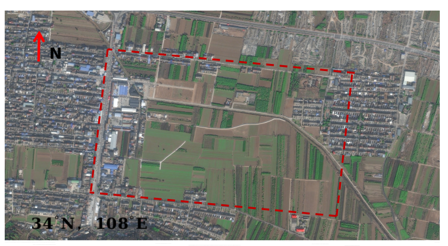

# AGGC-Zhouzhi Dataset

**A Real-World UAV–Satellite Cross-View Geo-Localization Dataset for Visual Place Recognition**

This repository introduces the **Zhouzhi** dataset, collected in a real-world UAV flight scenario to support research on UAV–satellite cross-view geo-localization and visual place recognition (VPR).

Related paper: **AGGC: A Training-Free Scene-Adaptive Gaussian Graph Covariance Aggregator for Visual Place Recognition**.

This repository provides dataset descriptions and download links.

## Study Area



*Study area of the Zhouzhi dataset. The red dashed line indicates the study-area boundary, and the arrow indicates north.*

The dataset was collected in **Zhouzhi County, Xi'an, Shaanxi Province, China**, covering an area of approximately **5 km²**. The area includes buildings, roads, and farmland, offering diverse visual structures for cross-view geo-localization research.

## Updates

- **2026-10-20:** Dataset documentation and download links for UAV data and satellite imagery were added.

## Dataset

### Overview

The Zhouzhi dataset comprises UAV sensor recordings, positioning ground truth, and satellite reference imagery. UAV data were collected at an approximate flight altitude of **120 m**.

The satellite reference is a **single, full-size image** covering the study area, rather than a gallery of pre-cut tiles. Researchers can crop the satellite image and construct reference galleries as needed. The satellite imagery is from **Jilin-1**, with an approximate ground sampling distance of **0.5 m**.

The dataset can support UAV–satellite image retrieval, visual place recognition, geo-localization, and related research.

### Sensor Setup

UAV imagery was collected using a rotorcraft equipped with a **Hikvision MV-CS050-10UM/UC** industrial camera.

The released UAV data are organized into four folders:

- **`camera/`** — Camera data.
- **`gnss/`** — Global Navigation Satellite System (GNSS) data.
- **`groundtruth/`** — Positioning ground-truth data.
- **`imu/`** — Inertial Measurement Unit (IMU) data.

The ROS bag recordings preserve synchronized, time-stamped UAV sensor data, including camera observations, GNSS/RTK positioning, and measurements from a MEMS IMU. The RTK-derived ground-truth trajectory, MEMS IMU stream, and sensor timing/synchronization information are especially valuable parts of the release, as these data are relatively scarce in public UAV geo-localization datasets. Together, they support trajectory evaluation, sensor-fusion research, and analysis of visual localization performance against positioning ground truth.

File formats, sampling rates, coordinate conventions, and the exact timestamp fields should be checked in the downloaded files before use.

## Download

The UAV data and the full-size satellite reference image are provided through **separate Baidu Netdisk links**.

### UAV Data and Ground Truth

Includes the `camera`, `gnss`, `groundtruth`, and `imu` folders.

**Download:** [Zhouzhi UAV data (Baidu Netdisk)](https://pan.baidu.com/s/1KKvf4K-36spPZizXZ4lY2g?pwd=vvpr)

**Extraction code:** `vvpr`

### Satellite Imagery

The satellite reference data are distributed separately as a **full-size satellite image**, not as pre-cut reference tiles.

**Download:** [Zhouzhi satellite imagery (Baidu Netdisk)](https://pan.baidu.com/s/18_1Z313u9TFDQgjZt86i9Q?pwd=vvpr)

**Extraction code:** `vvpr`

## Data Organization

The two downloadable components are organized conceptually as follows. Actual filenames within the shared folders may differ.

```text
Zhouzhi Dataset/
├── UAV Data/
│   ├── camera/
│   ├── gnss/
│   ├── groundtruth/
│   └── imu/
└── Satellite Imagery/
    └── Full-size satellite image
```

## Dataset Usage

Researchers may use the UAV camera data together with GNSS, IMU, and ground-truth information for visual localization, trajectory analysis, and related research. The full-size satellite reference image can be processed into a reference gallery to meet the requirements of a particular method.

Please ensure that the use and redistribution of individual data components comply with the applicable permissions and geographic-data regulations.

## Paper

**AGGC: A Training-Free Scene-Adaptive Gaussian Graph Covariance Aggregator for Visual Place Recognition**

Paper link: **To be added.**

The Zhouzhi dataset was used to study AGGC in a real-world UAV–satellite cross-view geo-localization scenario.

## Citation

Citation details will be provided when an official paper or preprint is available. Until then, please acknowledge the Zhouzhi dataset and this repository when using these data.

## License and Use

**Data terms: Pending confirmation.** Availability of a download link does not itself grant rights to redistribute third-party satellite imagery or other restricted data. Follow the relevant licensing terms and data-sharing requirements.

## Contact

For questions about the dataset, please open a GitHub Issue.
